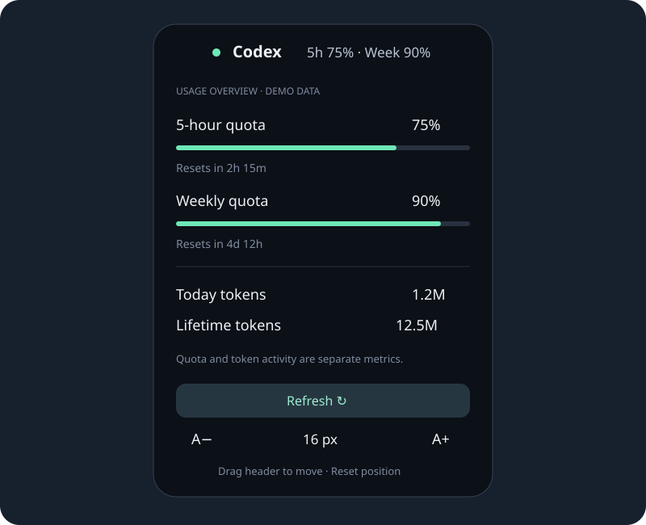

# Codex Island

适用于 **Linux GNOME Shell 46** 的 Codex 灵动岛用量悬浮窗：查看套餐余量、重置倒计时和账户 token 统计，无需反复打开用量页面。

[English](README.en.md) · [更新记录](CHANGELOG.md) · [MIT 许可证](LICENSE)



> 当前只声明支持 GNOME Shell 46，已在 Ubuntu / Wayland 上验证。不是 Windows、macOS、KDE 或其他 GNOME 版本的通用悬浮窗。界面目前为中文；英文说明不代表界面已完成本地化。

## 功能

- **收起胶囊**：显示服务端返回的短周期及每周额度余量。
- **悬停展开**：查看剩余百分比、进度条、重置倒计时、今日/累计/最近日 token。
- **点击固定**：展开后可以固定，移开鼠标不会收起。
- **拖动定位**：拖住顶部移动，保存位置；支持恢复顶部居中。
- **字号设置**：默认正文16px，可在12–24px之间调整，布局随字号变化。
- **自动刷新**：每120秒采集一次账户统计，每30秒更新倒计时与过期状态；也可手动刷新。
- **离线显示**：保留上次成功结果，标记离线或过期；未知数据用 `—`，不会伪装成0。
- **桌面集成**：不占用窗口工作区，使用GNOME的全屏隐藏机制。

## 环境要求

| 项目 | 要求 / 验证范围 |
| --- | --- |
| 桌面 | GNOME Shell 46；Ubuntu Wayland 已验证 |
| Python | 系统 Python 3，建议3.12；无需pip依赖 |
| GLib 工具 | `glib-compile-schemas` |
| Codex | 已安装且用自己的ChatGPT账号登录；已测试CLI 0.161.0 |
| 代理读取（可选） | `python3-gi`，用于继承GNOME手动代理 |
| 网络 | 能访问自己的Codex服务 |

每个人使用自己的Codex登录，不要复制别人的认证文件。不同账号、套餐和CLI版本可能返回不同的统计字段；不保证所有字段都可用。API-key-only登录不支持此处的ChatGPT账户token统计。

检查环境：

```bash
gnome-shell --version
python3 --version
command -v glib-compile-schemas
command -v codex
codex --version
```

Ubuntu如缺少运行依赖，可自行安装：

```bash
sudo apt install python3 python3-gi libglib2.0-bin
```

Codex CLI的安装与登录请参照[官方说明](https://learn.chatgpt.com/docs/app-server)。本项目不代为安装Codex、不修改其登录状态。

## 安装与启用

```bash
git clone https://github.com/yangz24/codex-island.git
cd codex-island
bash install.sh
```

安装器会检查GNOME版本，将文件安装到：

```text
${XDG_DATA_HOME:-~/.local/share}/gnome-shell/extensions/codex-island@yangz24.github.io/
```

**首次安装后，保存工作，注销Ubuntu并重新登录**，然后启用：

```bash
gnome-extensions enable codex-island@yangz24.github.io
gnome-extensions info codex-island@yangz24.github.io
```

应看到 `Enabled: Yes` 与 `State: ACTIVE`。安装器不会自动启用扩展、重启Shell或中断桌面会话。默认位置为主显示器顶部面板下方。

> 原始开发版使用 `codex-island@gino.local`，公开版使用新的UUID。若安装过开发版，先执行 `gnome-extensions disable codex-island@gino.local`，避免两个版本同时显示。

## 操作方法

| 操作 | 行为 |
| --- | --- |
| 鼠标悬停 / 离开 | 展开 / 收起；固定时不收起 |
| 左键点击顶部 | 固定 / 取消固定 |
| 按住顶部拖动 | 移动位置并自动保存；超过6px才作为拖动 |
| 拖动时Esc | 取消拖动 |
| 顶部获得键盘焦点后Enter或空格 | 固定 / 取消固定 |
| 顶部获得键盘焦点后Esc | 收起 |
| 展开底部 A− / A＋ | 调整字号 |
| 底部恢复位置按钮 | 恢复主屏顶部居中 |
| 右键顶部 / 点击刷新按钮 | 立即采集，已有请求进行时不会重复启动 |

字号和位置通过GSettings保存，重新登录后保留。拖动输入抓取最多持续10秒，避免丢失松开事件后无限占用输入。小于800逻辑像素高度的屏幕、较大系统缩放或超大字体组合未全面验证；如面板放不下，请降低字号。

## 数字的含义

**剩余额度与token消耗是两种不同指标。**

- 额度来自 `account/rateLimits/read`，剩余百分比为 `100 - usedPercent`，以服务端实际窗口长度为准。
- 账户token来自 `account/usage/read`，显示服务端累计值和每日桶；不是本地单个聊天的token计数。
- 剩余41%不意味着还能用某个固定数量的token，也不能直接换算成订阅费用。
- 今日桶按本机日期匹配服务端日期字符串。服务端分桶时区未明确，统计也可能延迟；没有今天的桶时显示 `—`，同时显示最近一次有数据的日期。
- 重置时间来自服务端时间戳；到时后如新快照尚未到达，会显示等待额度更新。
- 最后成功快照超过6分钟，或最新采集失败，会标记离线/过期；旧数字仍保留，不能视为实时值。

## 代理和PATH

### 桌面代理

GNOME桌面与终端的环境变量不一定相同。采集器按以下顺序选择代理：

1. 已有 `HTTP_PROXY` / `HTTPS_PROXY` / `ALL_PROXY` 及对应小写环境变量。
2. 没有上述变量时，通过可选PyGObject读取GNOME的**手动HTTP/HTTPS代理**，只传给自己的app-server子进程。
3. GNOME没有手动代理时，保留默认网络环境。

不会改系统代理设置，也不会读取GNOME代理密码。PAC自动代理脚本、仅SOCKS的GNOME代理设置、需要认证的GNOME代理暂不自动解析；这些环境需要自行配置桌面进程可继承的代理变量。已有环境变量优先，即使其值无效，也不会被GNOME设置覆盖。

### Codex可执行文件

采集器通过PATH查找 `codex`。仅在终端通过nvm/asdf初始化的PATH，可能无法被GNOME继承。终端能运行而悬浮窗提示未找到Codex时，应修正桌面会话PATH，然后重新登录。项目不会扫描认证文件来绕过CLI。

## 隐私与资源管理

- 使用官方 `codex app-server --stdio` 的只读统计接口，不发起模型推理请求。
- 复用本人已有登录，认证由Codex负责；采集器不直接读取认证文件、不解析聊天正文。
- Codex自身仍会管理其正常运行状态与认证刷新文件。
- 统计缓存位于 `$XDG_CACHE_HOME/codex-island/usage.json`，默认 `~/.cache/codex-island/usage.json`。
- 缓存原子替换，创建时即为0600权限；用文件锁防止手动采集与自动采集互相覆盖。
- 失败时仅保存安全错误类别和尝试时间，不保存原始服务端错误、凭据或完整日志。
- 单个RPC超时25秒；三个串行RPC加退出清理，正常上界约78秒，早于下一次120秒轮询。
- 停用扩展时发送终止信号；采集器清理自己的app-server进程组和管道。旧请求回调不会清空新请求状态。
- 仓库预览全部使用模拟数据，不含作者的真实用量、认证信息或桌面截图。

## 更新

```bash
cd codex-island
git pull --ff-only
bash install.sh
```

Wayland下更新JavaScript后仍需注销再登录，不能只依靠停用/启用加载新模块。安装器不更改已保存字号和位置。请先保存工作再注销。

## 停用、卸载与重置

停用：

```bash
gnome-extensions disable codex-island@yangz24.github.io
```

卸载扩展文件：

```bash
gnome-extensions uninstall codex-island@yangz24.github.io
```

缓存及GSettings偏好不会被自动删除。只重置字号或位置可使用界面按钮。需要恢复所有偏好时，在**扩展仍已安装**的情况下执行：

```bash
GSETTINGS_SCHEMA_DIR="${XDG_DATA_HOME:-$HOME/.local/share}/gnome-shell/extensions/codex-island@yangz24.github.io/schemas" \
  gsettings reset-recursively org.gnome.shell.extensions.codex-island
```

## 故障排查

| 现象 | 检查 / 处理 |
| --- | --- |
| 提示扩展不存在 | 检查安装目录、GNOME版本，首次安装后注销再登录 |
| 已启用但无胶囊 | 检查是否全屏、扩展是否ACTIVE；查看GNOME日志 |
| 未找到Codex | 检查桌面进程PATH，参见上文 |
| 一直显示旧数字 | 查看是否离线/过期、最近成功与尝试时间，检查代理和登录 |
| 今日token是 `—` | 可能是服务端尚未提供每日桶，不代表0 |
| CLI统计正常、桌面失败 | 检查桌面与终端的代理/PATH差异 |
| 两个胶囊 | 停用原始开发版或重复安装的扩展 |
| 字体过大、位置不理想 | 用A−或恢复顶部居中；必要时重置偏好 |

诊断命令：

```bash
gnome-extensions info codex-island@yangz24.github.io
python3 "${XDG_DATA_HOME:-$HOME/.local/share}/gnome-shell/extensions/codex-island@yangz24.github.io/collector.py"
journalctl --user -b --no-pager | rg 'codex-island|JS ERROR'
```

独立采集命令仅输出简要统计和安全错误类别。失败缓存中的 `updatedAt` 是最后成功时间，`attemptedAt` 是最近尝试时间；`codex_missing`、`timeout`、`rpc_error`、`server_closed`、`invalid_response`、`collection_failed` 分别对应找不到CLI、超时、接口错误、进程结束、协议结果无效及其他失败。

报告问题时请提供GNOME版本、发行版、CLI版本、症状和**去除隐私后的**错误类别；不要提交认证文件、访问令牌、完整环境变量或聊天记录。

## 开发、测试与已知边界

```bash
python3 -m unittest discover -p 'test_*.py' -v
python3 -m py_compile collector.py
node --input-type=module --check < extension.js
bash -n install.sh
glib-compile-schemas --strict --dry-run schemas
```

Python单元测试覆盖额度、缺失/非法数据、局部接口失败、坏缓存恢复、缓存锁、超时回收、权限及代理优先级。GitHub Actions执行这些测试和静态检查。

桌面事件回归可在本机运行（需要GNOME46、软件渲染和D-Bus工具）：

```bash
bash tests/headless-input.sh
```

该脚本创建私有无头合成器、临时配置和模拟用量，不调用Codex、不修改现有桌面设置；其测试副本仅在私有会话中开启调试功能。请勿将测试插桩用于主桌面。

另在独立GNOME46无头Wayland会话中测试实际渲染、字号与位置恢复、完整虚拟鼠标按下/移动/松开及丢失松开时的超时释放。此类桌面回归依赖GNOME运行环境，不在普通GitHub Actions中执行。作者机器上已观察到真实桌面定时刷新成功；不代表所有硬件、多屏布局或缩放组合都已验证。

未公开的开发版v2曾因输入抓取监听位置错误锁住桌面交互。公开仓库不含该版源码；当前版本在抓取actor自身处理事件，并加入有界抓取和退出清理。问题经过实际事件链复现和修复，不将函数级测试等同于桌面事件验证。

## 项目结构

```text
extension.js       GNOME界面、拖动、布局与刷新调度
collector.py       只读统计RPC、代理、缓存及子进程清理
stylesheet.css     胶囊与展开面板样式
schemas/           字号与位置的GSettings schema
install.sh         本地用户安装，不自动启用
test_collector.py  采集器与代理回归
docs/preview.svg   使用模拟数据的预览
```

## 参考与许可证

独立实现，未复制第三方源码。交互参考 [Agent Usage Widget](https://github.com/chunnylab/agent-usage-widget) 与 [Dynamic Island for Linux](https://github.com/kimxuanhong/dynamic-island-linux)；数据接口参考 [Codex App Server官方文档](https://learn.chatgpt.com/docs/app-server)。

采用[MIT许可证](LICENSE)。本项目不隶属于OpenAI或Apple，也未获其官方背书。
